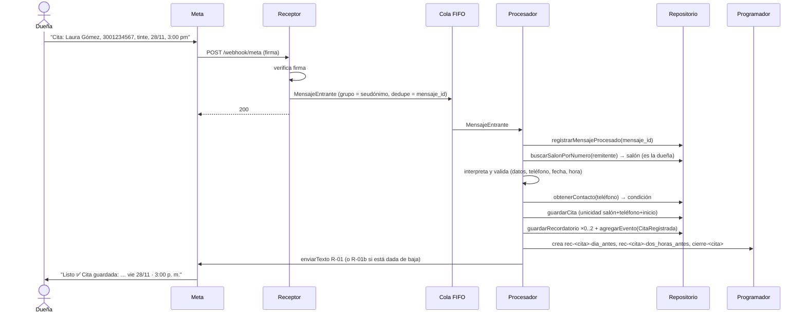
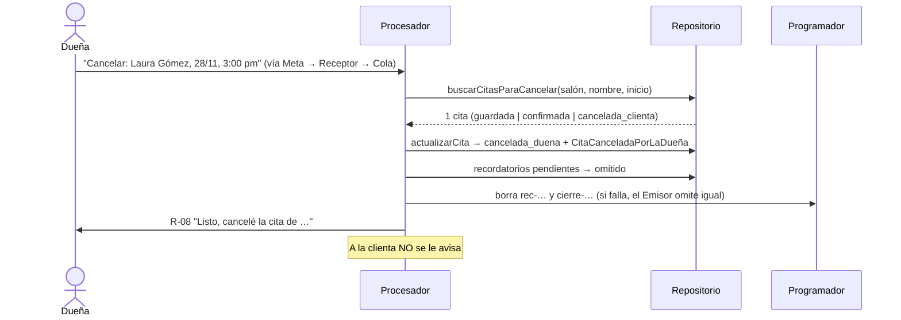
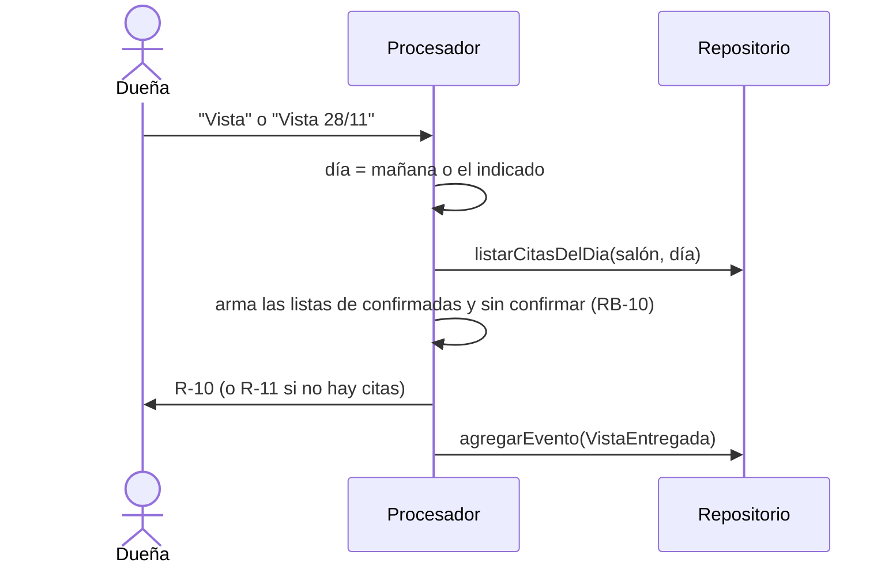
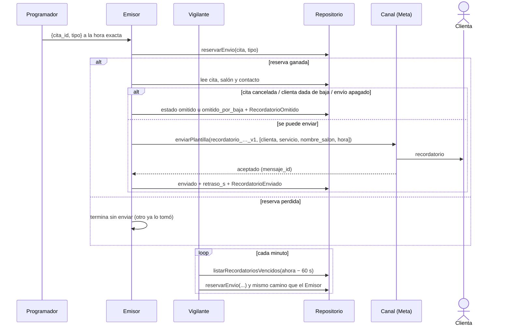
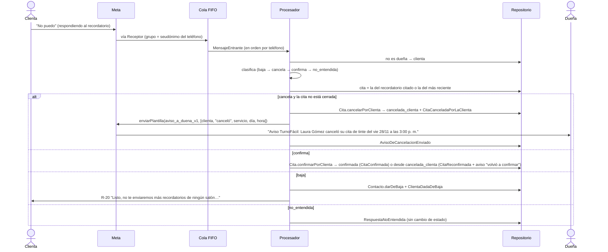
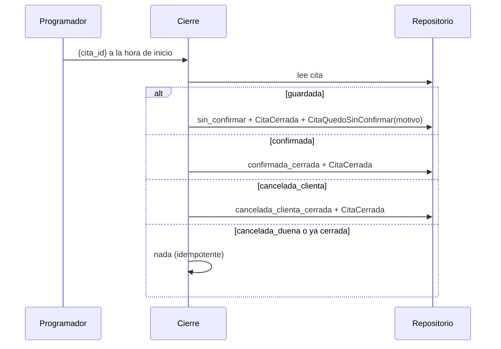
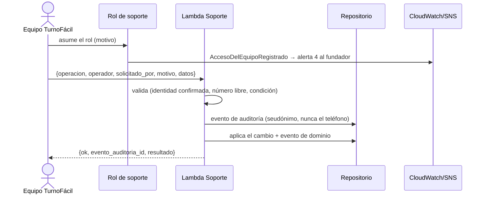

# Integration Flows · TurnoFácil

**Date:** 2026-11-24
**Versión del contrato:** 1.0.0
**Base:** docs/RFC.md § 2.1 y § 2.1.4 · docs/domain-model.md · docs/api-contract.md · docs/events.md · flujos aprobados docs/flows/turnofacil/user-flows.md (F1 a F5)

---

## Resumen para decidir

- Siete flujos de integración cubren todo lo que cruza más de una pieza del sistema: registrar, cancelar, pedir la vista, enviar un recordatorio (con sus fallos), recibir la respuesta de la clienta (con el aviso a la dueña), cerrar la cita y las operaciones de soporte.
- Cada flujo muestra el camino feliz y los caminos de error, con el estado final y la alerta que corresponde.
- El punto más delicado es el envío del recordatorio (FI-4). Dos caminos pueden intentar enviar lo mismo, el programador y el vigilante, y solo envía el que gana la reserva. Así se cumplen los 5 minutos sin mandar duplicados.

**Participantes:** Meta (WhatsApp Business Platform) · Receptor (Lambda) · Cola FIFO de entrantes + DLQ · Procesador (Lambda con el dominio) · Repositorio (puerto) · Programador (EventBridge Scheduler) · Emisor (Lambda) · Vigilante (Lambda, cada minuto) · Cierre (Lambda) · Soporte (Lambda) · Canal (puerto `CanalWhatsApp`) · CloudWatch/SNS.

---

## FI-1 · La dueña registra una cita (F1 · US-01)

**Caminos de error:**
| Situación | Qué pasa | Estado final | Alerta |
|---|---|---|---|
| Firma inválida | Receptor responde 401, no encola | Nada | — |
| `mensaje_id` ya procesado (reentrega de Meta) | El Procesador lo ignora sin responder | Sin cambios | — |
| El remitente no es la dueña | No se ejecuta ni se responde (US-01·1.9) | Sin cambios | — |
| Falta un dato, teléfono inválido, fecha pasada o duplicada | `RegistroRechazado` y respuesta `R-02` a `R-05` | La cita no existe | — |
| Hora 7, 8 o 9 sin a. m. ni p. m. | Respuesta `R-13` ("¿mañana o noche?"). El comando queda `pendiente_aclaracion`. Con la respuesta de la dueña se termina de validar y se guarda; si envía otro comando o pasan 30 minutos, se descarta (api-contract § 3.1.1.1) | La cita no existe hasta la aclaración | — |
| Una hora de recordatorio ya pasó | Ese recordatorio no se crea (US-02·2.8) | Cita `guardada` con 1 o 0 recordatorios | — |
| Clienta dada de baja | Se guarda la cita sin recordatorios y se responde `R-01b` | Cita `guardada` | — |
| Falla el repositorio | Respuesta `R-07` y métrica de fallo de guardado | La cita no existe | Alerta 3 |
| Falla crear un evento programado | La cita y el recordatorio quedan guardados en `programado`; el vigilante lo enviará (FI-4) | Cita `guardada` | Solo si el vigilante tampoco lo envía a tiempo |
| El Procesador falla tras los reintentos de la cola | El mensaje va a la DLQ | Sin cambios | Alarma de DLQ |

---

## FI-2 · La dueña cancela una cita (F2 · US-01·1.3)

**Caminos de error:**
| Situación | Qué pasa | Estado final |
|---|---|---|
| Ninguna coincidencia, o la cita ya está en un estado final | `CancelacionNoEncontrada` y respuesta `R-09` | Sin cambios |
| Varias coincidencias | Respuesta `R-09b` pidiendo el teléfono | Sin cambios |
| Llega una respuesta de la clienta al mismo tiempo | La escritura condicional por versión deja ganar a una sola. La otra relee y vuelve a aplicar. Desde `cancelada_duena` la respuesta de la clienta es `transicion_invalida` y no se aplica | `cancelada_duena` |
| Falla el repositorio | Respuesta `R-07` (alerta 3) | Conserva su estado |

---

## FI-3 · La dueña pide la vista (F3 · US-03)

**Caminos de error:** día no entendido → `R-12`. Remitente que no es la dueña → no se responde. Respuesta lenta: la métrica de latencia mide contra los 10 s.

---

## FI-4 · Envío de un recordatorio (F4 · US-02 · ADR-003, ADR-004)

**Verificaciones antes de enviar** (api-contract § 4.3; Inv-REC-04):
| Condición | Recordatorio 1 | Recordatorio 2 |
|---|---|---|
| Cita `cancelada_clienta` o `cancelada_duena` | `omitido` | `omitido` |
| Clienta `dada_de_baja` | `omitido_por_baja` | `omitido_por_baja` |
| Cita `confirmada` | No puede ocurrir: la confirmación llega después del recordatorio 1 | **Se envía** (RB-06) |
| Interruptor del salón o general apagado | `omitido` (motivo `envio_apagado`) | `omitido` (motivo `envio_apagado`) |

**Caminos de error** (ADR-004):
| Situación | Qué pasa | Estado final | Alerta |
|---|---|---|---|
| Error transitorio | Reintenta a los 10 s y a los 30 s. Si sigue fallando, pasa a `reintentar` y el vigilante lo retoma cada minuto | `enviado` (o `enviado_tarde` si pasó de 300 s) | Retraso mayor a 300 s → alerta 1 |
| Recordatorio 2 sin éxito tras 300 s | No se reenvía | `incumplido` + `RecordatorioIncumplido` | Alerta 1 |
| Recordatorio 1 sin éxito tras 300 s | Se reintenta cada 5 minutos hasta la hora del recordatorio 2; entonces queda `incumplido` | `enviado_tarde` o `incumplido` | Alerta 1 |
| Error permanente | No reintenta | `no_entregable` + `MensajeNoEntregado` | Alerta 2 |
| Meta informa `failed` después por webhook | Procesador registra el estado, sin reintento | `no_entregado` + `MensajeNoEntregado` | Alerta 2 |
| El evento programado nunca llega | El vigilante lo detecta a los 60 s | `enviado` | Vencidos sin enviar durante 2 min → alerta 1 |
| El vigilante deja de ejecutarse | — | — | Falta de latido → alarma |
| El Emisor muere con la reserva tomada (`enviando`) | El vigilante trata como vencido todo `enviando` de más de 120 s y lo pasa a `reintentar` antes de reservar. Puede generar un duplicado solo si el canal ya aceptó el envío y el registro no alcanzó a guardarse `[DECISIÓN TÉCNICA ETAPA 10]` | `enviado` | — |

---

## FI-5 · La clienta responde (F4 · US-02 · US-04)

**Reglas y caminos de error:**
| Situación | Qué pasa |
|---|---|
| "sí" y después "cancelo" en segundos | La cola FIFO por teléfono los aplica en orden. Vale el último (RB-05) |
| Respuesta después del inicio | Se guarda con `aplicada: false`. Sin cambio de estado y sin aviso (Inv-CIT-07) |
| "cancelo" sobre una cita ya `cancelada_clienta` | No hay transición. No se repite el aviso |
| "sí" sobre una cita ya `confirmada` | No hay transición ni evento |
| Respuesta sobre `cancelada_duena` | `transicion_invalida`. Se guarda sin efecto y sin aviso |
| Baja con una cita confirmada | La cita sigue `confirmada` (Inv-CON-04). Los recordatorios pendientes de todos los salones quedarán `omitido_por_baja` |
| Teléfono sin recordatorios enviados | Se guarda la respuesta sin cita y sin efecto. No se responde (salvo baja) |
| El aviso a la dueña falla | Reintentos de FI-4 para errores transitorios. Si es permanente: `no_entregado` y alerta 2. El cambio de estado de la cita se mantiene |
| Clienta con citas en dos salones que no usa "responder" | Se asocia al recordatorio enviado más recientemente (supuesto A7 del RFC). El nombre del salón en el recordatorio ayuda a que use "responder" |

---

## FI-6 · Cierre de la cita (F4 A2c · RF-10)

**Caminos de error:** si el evento de cierre no llega, el vigilante también busca citas con `inicio` pasado en estados no finales y las cierra. Hasta entonces, el Procesador compara la hora de cada respuesta con el `inicio` y no aplica las posteriores, así que el resultado no cambia aunque el cierre llegue tarde. `[DECISIÓN TÉCNICA ETAPA 10]`

---

## FI-7 · Operaciones de soporte (F5 · RF-11)

**Caminos de error:** cualquier validación fallida devuelve el `codigo` de api-contract § 5, sin cambios. Primero se guarda el evento de auditoría y después el cambio: si el cambio falla, la auditoría queda con `resultado: fallido` y el intento queda registrado igual.

---

## Cobertura

| Flujo aprobado (user-flows.md) | Flujo de integración |
|---|---|
| F1 Registrar | FI-1 |
| F2 Cancelar por la dueña | FI-2 |
| F3 Vista | FI-3 |
| F4 Recordatorios y respuestas (incluye aviso de cancelación, A2b, A2c, A3, A6) | FI-4, FI-5, FI-6 |
| F5 Soporte | FI-7 |
